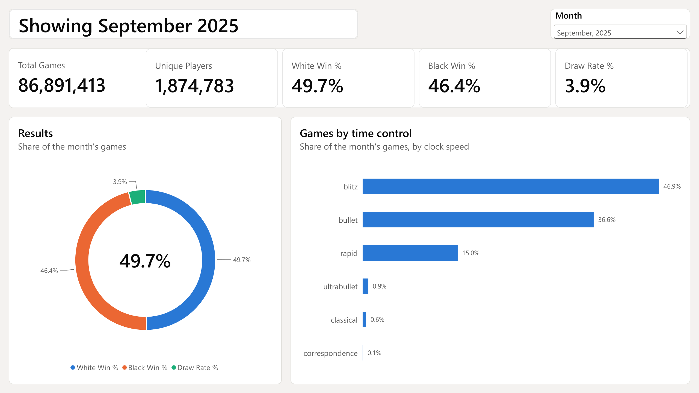
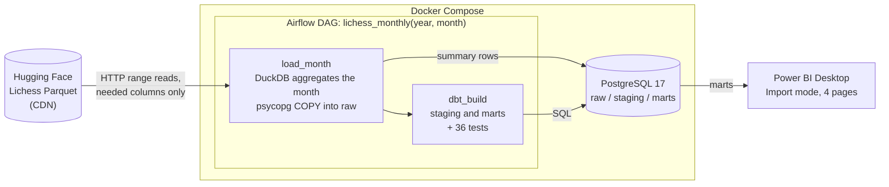
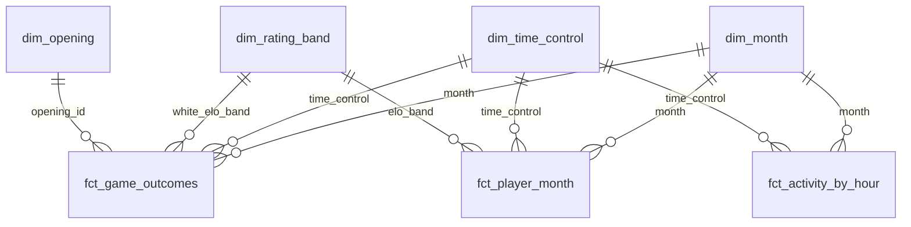
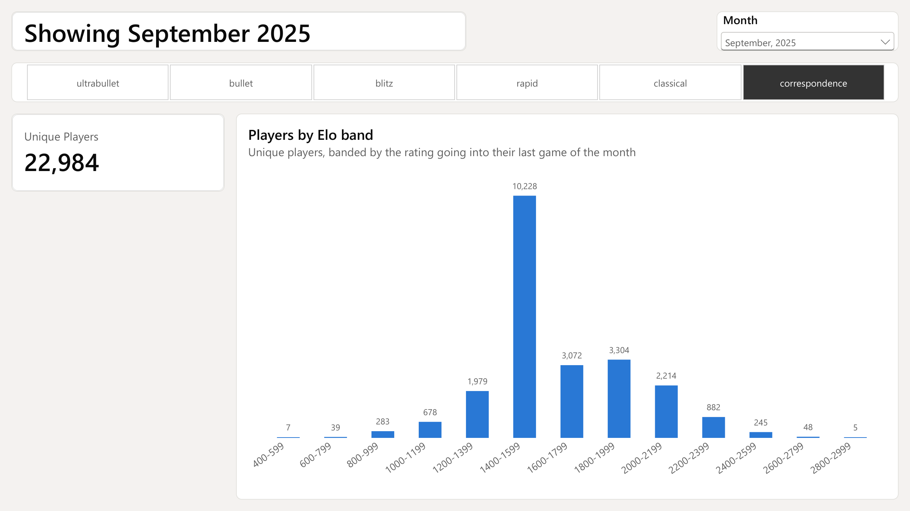
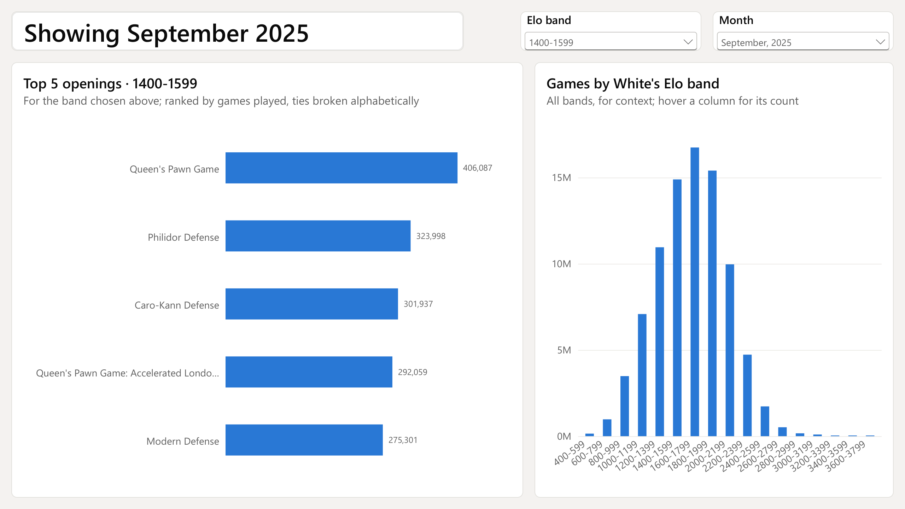
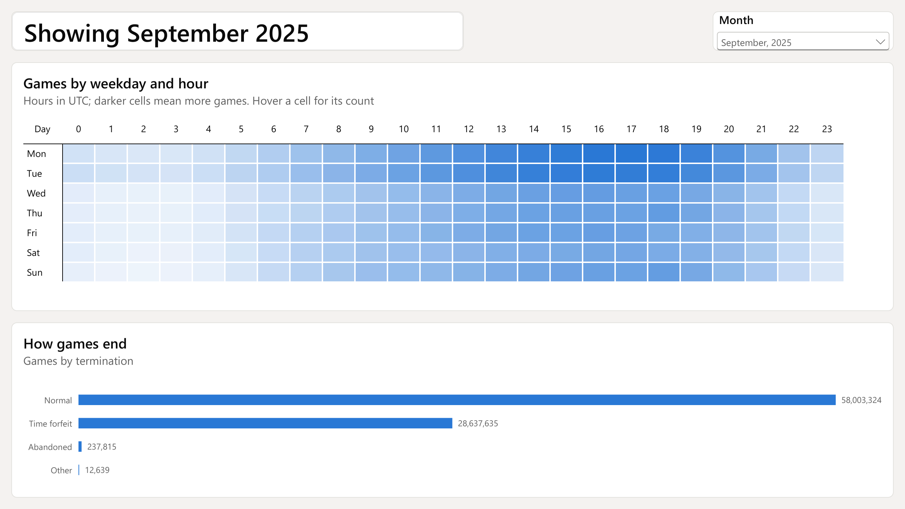

# Lichess ETL

An on-demand batch pipeline that turns one month of the public Lichess game archive into a tested analytics warehouse and a Power BI dashboard.

A single Airflow trigger selects a year and month. DuckDB streams that month's Parquet files from Hugging Face, reads only the columns it needs, and aggregates the games as it reads, so no raw data is written to disk. The resulting summary tables are loaded into PostgreSQL in a rerun-safe transaction. dbt then builds a tested star schema, and a four-page Power BI report presents the month.

**Headline result.** The latest available month, September 2025 (87,049,890 games in 62 files totalling 62.5 GB), is processed end to end in 33 minutes on a laptop, with a peak of 5.9 GB of memory. DuckDB transfers about 11.5 GB of the 62.5 GB, and all 36 data tests pass.



## Contents

- [Architecture](#architecture)
- [Technology stack](#technology-stack)
- [Data model](#data-model)
- [Data quality](#data-quality)
- [Dashboard](#dashboard)
- [Getting started](#getting-started)
- [Development](#development)
- [Repository layout](#repository-layout)
- [Design decisions](#design-decisions)
- [Performance](#performance)
- [Findings](#findings)
- [Issues found and resolved](#issues-found-and-resolved)
- [Limitations and future work](#limitations-and-future-work)
- [Data source and licence](#data-source-and-licence)

## Architecture



The pipeline runs in four steps:

1. **Locate the files.** `month_urls` lists the month's Parquet files through the Hugging Face API and resolves each one to a short-lived CDN link (one lookup per file).
2. **Extract and aggregate.** DuckDB reads the files over HTTP. It requests only the byte ranges of the columns a query needs (never the move text, about 94% of each file) and aggregates as it reads. Three queries produce three summary tables: game outcomes, player-months and activity by hour.
3. **Load.** `replace_month` deletes the month's existing rows and bulk-loads the new ones with `COPY`, in a single transaction. Rerunning a month therefore replaces it and never duplicates it.
4. **Transform and test.** dbt rebuilds the staging and mart models and runs every data test. A failing test fails the Airflow run.

The DAG has no schedule (`schedule=None`). Each run is triggered manually with `year` and `month` parameters.

## Technology stack

| Component | Version | Role | Why it was chosen |
| --- | --- | --- | --- |
| Hugging Face dataset `Lichess/standard-chess-games` | — | Source data | Every rated Lichess game as monthly Parquet files, CC0 licence |
| DuckDB | 2.0.0 | Extraction and aggregation | Reads remote Parquet with column pruning and aggregates in-process, within a 2 GB memory limit, with no server to run |
| pandas, psycopg 3 | 3.1.0, 3.3.6 | Load | Hands DuckDB results to Postgres through the `COPY` bulk-load protocol |
| PostgreSQL | 17 | Warehouse | A shared, always-on database that both dbt and Power BI connect to natively |
| Apache Airflow | 3.3.2 | Orchestration | Parameterised runs, task ordering, run history and logs; LocalExecutor is sufficient on one machine |
| dbt (core, postgres) | 1.12.6, 1.11.0 | Transformation and testing | Version-controlled SQL models in dependency order, with data tests on every build |
| Docker Compose | — | Environment | Reproducible services with pinned versions; dbt has its own virtualenv in the image |
| Power BI Desktop | — | Reporting | Import mode over the marts, with DAX measures for the report logic |
| pytest | 9.2.0 | Unit tests | Tests the extraction rules against a local Parquet fixture, without network, Airflow or Docker |

## Data model

### Raw layer (loaded by Airflow)

| Table | Grain | Measures |
| --- | --- | --- |
| `raw.game_aggregates` | month × time-control class × White Elo band × Black Elo band × ECO × opening × termination | games, White wins, Black wins, draws |
| `raw.player_month` | month × player × time-control class | games, wins, average rating, last rating, Elo band |
| `raw.activity_by_hour` | month × weekday × hour (UTC) × time-control class | games |

Elo bands are 200 points wide and named by their lower edge (1400 means 1400–1599). Time-control classes follow Lichess's estimated-duration rule: base time + 40 × increment, giving ultrabullet, bullet, blitz, rapid, classical and correspondence.

### Staging and marts (built by dbt)

The staging models rename columns, fill missing text and group rare terminations into `Other`. The marts form a star schema:



A player's Elo band is taken from their rating going into their last game of the month, so each player falls into exactly one band per time control.

## Data quality

**Counting rule.** A game is counted only if both players are rated and it has a result (`1-0`, `0-1` or `1/2-1/2`). The rule is defined once, as the DuckDB table macro `counted_games` in `include/extract.py`, and all three extraction queries read from it. As a result, the three raw tables always describe the same set of games.

**dbt tests (36 in total):**

- `unique` and `not_null` on every dimension key;
- `relationships` from every fact key to its dimension;
- `accepted_values` on time-control class and termination;
- four singular tests:
  - White wins + Black wins + draws = games, on every fact row;
  - activity totals equal game-outcome totals, for every month;
  - player games equal exactly twice the games, for every month (each game has two players);
  - weekday is 1–7 and hour is 0–23.

**Unit tests (14, pytest):** an eleven-game Parquet fixture covers the time-control boundaries, the Elo band edges, last-rating selection, ISO weekdays and both exclusion rules. The fixture has no move-text column, so the tests fail if an extraction ever starts reading it.

## Dashboard

The report (`powerbi/lichess.pbix`) has four pages, each filtered by a single month selector. Every value shown was verified against PostgreSQL with DAX queries during development.

| Page | Content |
| --- | --- |
| 1. Month overview | Cards for games, unique players and the White win, Black win and draw rates; results donut; share of games by time control |
| 2. Players by Elo band | Unique players per band, filtered to one time control at a time |
| 3. Openings by band | The top five openings for a chosen White Elo band, beside the distribution of games across all bands |
| 4. When and how games end | Weekday × hour (UTC) heatmap; games by termination |

| | |
| --- | --- |
|  |  |
|  | |

Key DAX measures:

```dax
Total Games    = SUM ( fct_game_outcomes[games] )
Unique Players = DISTINCTCOUNT ( fct_player_month[player_id] )
White Win %    = DIVIDE ( SUM ( fct_game_outcomes[white_wins] ), [Total Games] )
Share of Games = DIVIDE ( [Total Games], CALCULATE ( [Total Games], ALL ( dim_time_control ) ) )
Opening Rank   =
    IF (
        ISINSCOPE ( dim_opening[opening_name] ) && NOT ISBLANK ( [Total Games] ),
        RANK ( ALLSELECTED ( dim_opening[opening_name] ),
               ORDERBY ( [Total Games], DESC, dim_opening[opening_name], ASC ) )
    )
```

`Opening Rank` breaks ties alphabetically, so a band never shows more than five openings.

## Getting started

### Prerequisites

- Docker Desktop with at least 8 GB of memory for its virtual machine (WSL 2 on Windows).
- About 10 GB of free disk space: about 4.5 GB for the Docker images, plus about 1 GB of Postgres data per recent month.
- A stable internet connection. A recent month transfers about 11.5 GB.
- Power BI Desktop (Windows), to view the report.
- Python 3.12 or later, only for the unit tests.

### 1. Configure

```bash
git clone https://github.com/MitPatel2409/lichess-etl.git
cd lichess-etl
cp .env.example .env
```

Edit `.env` and replace both `change-me` values: `POSTGRES_PASSWORD` is the database password, and `AIRFLOW_JWT_SECRET` is any long random string. `.env` is git-ignored. `.env.example` holds placeholders only.

### 2. Start the services

```bash
docker compose up -d --build
```

This starts PostgreSQL (port 5432) and the Airflow API server, DAG processor and scheduler. On first start, `sql/init.sql` creates the Airflow metadata database and the `raw` tables. The Airflow UI is available at <http://localhost:8081> after about 30 seconds. It is bound to localhost and has no login.

### 3. Load a month

In the Airflow UI, open **Dags → lichess_monthly → Trigger**, enter a `year` and `month` (for example `2025` and `9`), and confirm. Alternatively, from the command line:

```bash
docker compose exec airflow-scheduler airflow dags trigger lichess_monthly -c '{"year": 2025, "month": 9}'
```

In Git Bash on Windows, prefix the command with `MSYS_NO_PATHCONV=1`.

The run is complete when both tasks, `load_month` and `dbt_build`, succeed. Any month from January 2013 to the latest month published on Hugging Face can be loaded. Reloading a month replaces it.

### 4. Open the report

Open `powerbi/lichess.pbix` in Power BI Desktop and select **Home → Refresh**. If prompted, connect to `localhost` / `lichess` with **Database** credentials (the user and password from `.env`) and accept an unencrypted local connection. Then choose the month in the **Month** selector.

### 5. Stop

```bash
docker compose down        # keeps the loaded data
docker compose down -v     # also deletes the database volume
```

## Development

```bash
python -m venv .venv
.venv/Scripts/activate            # Windows; use `source .venv/bin/activate` on Linux or macOS
pip install -r requirements.txt
pytest                            # 14 tests; no network, Airflow or Docker required
```

| Task | Command |
| --- | --- |
| Load a month without Airflow (Postgres must be running) | `python scripts/run_month.py 2025 9` |
| Run dbt by hand inside the container | `docker compose exec -w /opt/airflow/dbt/lichess airflow-scheduler /opt/dbt-venv/bin/dbt build` |
| Inspect the source schema of January 2013 | `python scripts/explore.py` (writes `docs/schema.md`) |

## Repository layout

```
airflow/
  Dockerfile               Airflow image with DuckDB, plus a separate dbt virtualenv
  dags/lichess_monthly.py  The DAG: load_month >> dbt_build
include/
  extract.py               File lookup, the counting rule and the three DuckDB queries
  load.py                  Rerun-safe load: delete the month, then COPY, in one transaction
dbt/lichess/
  models/staging/          The raw tables with standard names and terminations
  models/marts/            Star schema: three facts, four dimensions
  tests/                   Singular data tests
sql/init.sql               Airflow metadata database and the raw tables
tests/test_extract.py      Unit tests for the extraction rules
scripts/                   Run a month without Airflow; explore the source schema
powerbi/lichess.pbix       The Power BI report
docs/schema.md             Source schema and sample rows
images/                    Report screenshots
```

## Design decisions

1. **Aggregate while reading; store no raw data.** A recent month is about 62 GB of Parquet, most of it move text the analysis never uses. Reading only the needed columns and keeping only aggregates holds the whole four-month warehouse to 1.35 GB. The trade-off is that a change to the counting rules requires re-reading the source (see [Limitations](#limitations-and-future-work)).
2. **DuckDB for processing, PostgreSQL for serving.** DuckDB is efficient for scanning remote columnar files but is an embedded, single-writer engine. PostgreSQL is a shared server that dbt and Power BI can use concurrently, through Power BI's built-in connector.
3. **CDN links instead of `hf://` paths.** Reading through `hf://` costs one Hugging Face API lookup per Parquet row group. Recent months contain 87,000–99,000 row groups, which exceeds the limit of 3,000 lookups per five minutes. Resolving each file to its CDN link once reduces this to one lookup per file. The links expire after one hour, so each query resolves fresh ones.
4. **Rerun-safe loads.** Each month is replaced in a single transaction: delete, then `COPY`. A failed load leaves the previous data intact, and a repeated load never duplicates rows.
5. **One counting rule, defined once.** All three extraction queries read from the `counted_games` macro, so the facts always agree on which games exist.
6. **On-demand runs.** The DAG has no schedule. A month is loaded when it is requested, which suits an archive that changes once a month.
7. **Tests that fail the run.** dbt runs inside the DAG, so a data-quality failure is reported as a failed run rather than surfacing later in the report.

## Performance

Measured on a Windows 11 laptop (16 GB RAM, 12 logical processors), with Docker allocated 8 GB:

| Month | Games in source | Source size | `load_month` | `dbt_build` | Total | Peak memory (task container) |
| --- | --- | --- | --- | --- | --- | --- |
| January 2016 (12 threads, before tuning) | 4,770,357 | 8 files, 1.87 GB | 17 min 26 s | 9 s | 17 min 35 s | 1.6 GB |
| **September 2025** | **87,049,890** | **62 files, 62.5 GB** | **32 min 38 s** | **17 s** | **33 min** | **5.9 GB** |

For September 2025:

- **Data transferred:** about 11.5 GB of the 62.5 GB source, across the three extraction passes.
- **Output:** 785,021 game-aggregate rows, 2,863,871 player-month rows (1,874,784 unique players) and 1,008 activity rows.
- **Memory:** the peak of 5.9 GB, against a container limit of 7.6 GB, occurs during the player-month aggregation. Airflow accounts for about 0.7 GB, and DuckDB is limited to 2 GB.

### Bottleneck analysis

The extraction is **latency-bound**, not limited by bandwidth or CPU. The source files are divided into row groups of 1,000 games (87,110 for September 2025), so DuckDB issues several hundred thousand small HTTP range requests. Each request transfers only tens of kilobytes, and most of its time is spent waiting for the round trip. During the September 2025 run, the task averaged 148% CPU out of 1,200%, and throughput was 3–7 MB/s on a connection measured at about 14 MB/s for a single large transfer.

Because the threads mostly wait, DuckDB's thread count was raised above the number of processors. On one extraction pass over January 2016:

| DuckDB threads | Time | Speed-up |
| --- | --- | --- |
| 12 (default, one per logical processor) | 43 s | 1.0× |
| **32 (chosen)** | **18 s** | **2.4×** |
| 64 | 18 s | 2.4× |

Moving from 12 to 32 threads gives 2.7 times as many concurrent requests, and the measured speed-up of 2.4× is close to that ideal. Beyond 32 threads the bottleneck moves to the network connection and the server's per-client limits, so additional threads bring no gain. The speed-up of a complete run is expected to be smaller than that of a single pass, because part of the pipeline is sequential: resolving file links, merging partial aggregates, the load into PostgreSQL and the dbt build. By Amdahl's law, that sequential fraction bounds the overall speed-up. The end-to-end effect was not measured separately; both September 2025 runs used 32 threads.

## Findings

Observations from September 2025 (86,891,413 counted games, 1,874,783 unique players as counted by Power BI):

- **Speed of play.** Blitz accounts for 46.9% of games and bullet for 36.6%, so over 83% of games are played at fast time controls. Classical (0.6%) and correspondence (0.1%) are marginal.
- **Results.** White wins 49.7% of games and Black 46.4%. Draws are rare at 3.9% (3.3% in January 2013).
- **Draws increase with rating.** In games between players of the same band, the draw rate rises from 3.1% at 1200–1399 to 4.5% at 2000–2199 and 7.0% at 2600–2799. The highest bands behave differently, for example 81.6% draws at 3000–3199, which most likely reflects engine (bot) accounts rather than human play. This was not verified.
- **How games end.** 66.8% of games end normally (checkmate, resignation or agreement) and 33.0% on time. Abandonment accounts for 0.27%.
- **When games are played.** Activity peaks on weekday afternoons in UTC, with the single busiest hour on Monday at 17:00 (893,355 games), and is lowest on Sunday at 02:00–03:00 UTC. Monday and Tuesday have the highest daily totals only because September 2025 contains five of each of those weekdays and four of every other. The totals are not normalised per weekday.
- **Openings.** Queen's Pawn Game is the most played opening in every White band from 400 to 2799. From 2800 upwards, the Ruy Lopez: Berlin Defense leads. The rest of each top five shifts with rating (page 3 of the report).

## Issues found and resolved

Loading recent months exposed four issues that the 2013 data had not. Each was diagnosed from logs or data and fixed in code:

1. **Hugging Face rate limit (HTTP 429).** The first run of January 2024 failed after four minutes: reading through `hf://` made one API lookup per row group. Fixed by resolving CDN links once per file (decision 3).
2. **Interrupted network connection.** A connection drop 40 minutes into a run failed it, because a DuckDB query cannot resume. DuckDB now retries failed reads with exponential back-off for up to about four minutes. Longer outages require rerunning the month, which is safe.
3. **Games without a result.** The first September 2025 load failed the test that wins, losses and draws add up to games. 158,477 games (0.18%) had the result `*`. They were abandoned or unterminated, and about 85% had no moves or only White's first move. No such games occur in the 2013 or 2016 data. The counting rule now excludes them, and the month was rebuilt by re-reading the source (a backfill), after which all tests pass.
4. **Request concurrency.** The extraction was waiting on the network rather than computing. Raising DuckDB to 32 threads made a measured extraction pass 2.4 times faster (see [Performance](#performance)).

## Limitations and future work

- **Rebuilds require re-reading the source.** Because no raw data is stored, any change to the counting rules means reading the month from Hugging Face again (33 minutes for September 2025). Persisting only the needed columns as local Parquet (about 4 GB for that month) would make rebuilds take minutes, at the cost of disk space. This is the bronze layer of a medallion architecture.
- **A failed test does not block the report.** dbt builds the models before testing them, so data that fails a test still reaches the marts. A write-audit-publish pattern (build into a separate schema, test, then swap) would keep the last good data visible instead.
- **Runs are not resumable.** A month is processed as a whole. Processing per file or per day would make a failure cheaper to retry.
- **Username case.** Lichess usernames are case-insensitive, but one September 2025 account appears under two capitalisations. PostgreSQL counts 1,874,784 unique players and Power BI, which compares text case-insensitively, counts 1,874,783. Normalising player names to lower case in staging would make both agree.
- **Report file size.** The Import-mode report stores its data and is about 51 MB with four months loaded. GitHub warns above 50 MB and rejects files above 100 MB.
- **Single machine.** The design targets one machine. At larger scale, the same roles map to a distributed engine (for example Spark) and a cloud warehouse.

## Data source and licence

Game data comes from the [Lichess open database](https://database.lichess.org/), published on Hugging Face as [`Lichess/standard-chess-games`](https://huggingface.co/datasets/Lichess/standard-chess-games) under the CC0 1.0 licence.
